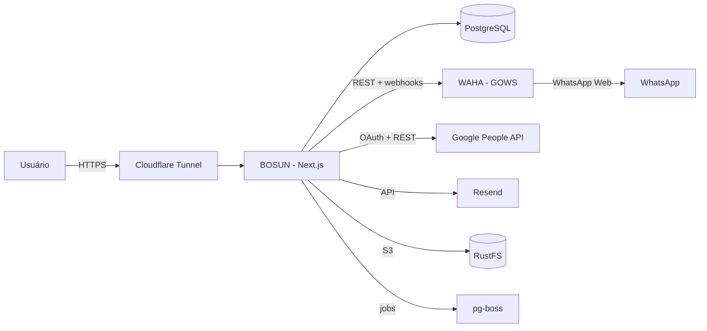

# Arquitetura

A BOSUN é uma aplicação web multiusuário. O MVP cobre onboarding, contatos e atendimento por WhatsApp, com sincronização via Google People API.

> **Nota 2026-10-22 — ADR-101:** cada cliente tem uma **instalação dedicada** (uma VPS), com banco, arquivos e backup próprios. O isolamento entre clientes é por instalação; `workspace_id` continua separando workspaces dentro dela. A arquitetura, o modelo de dados e o deploy serão reconciliados com essa decisão.

## Contexto

## Módulos

| Módulo | Responsabilidade |
|---|---|
| Auth | Login, sessão, convite, senha temporária e troca forçada |
| Workspace | Espaço, membros, papéis e permissões |
| Contacts | Contatos, métodos de contato, identidade e sync Google |
| WhatsApp | Sessões WAHA, QR, status, webhook e envio |
| Inbox | Conversas, mensagens, fila FIFO, atribuição e status |
| Google Sync | OAuth, etiqueta BOSUN, sync incremental e conflitos |
| Audit | Registro de ações sensíveis |
| Settings | Contexto, status, retenção, canais e integrações |
| Media | Upload, storage S3, URLs assinadas e expurgo |
| Jobs | Webhooks, sync, expurgo e notificações |

## Limites internos

- **App Router** para UI e route handlers; server actions para mutações internas.
- **Domínio** concentra regras de negócio e não depende de WAHA, Google ou S3.
- **Adaptadores** isolam providers externos: `WhatsAppProvider`, `GoogleContactsProvider`, `StorageProvider`, `EmailProvider`.
- **Prisma** é a camada de persistência; consultas por workspace sempre filtram `workspace_id`; o isolamento entre clientes é por instalação.
- **pg-boss** executa jobs no PostgreSQL, sem Redis.
- **RBAC** é resolvido no servidor por recurso/ação; a UI apenas reflete permissões efetivas.

## Fluxos principais

### Onboarding

1. Usuário cria conta e espaço; recebe Admin.
2. Configura contexto.
3. Cria sessão WhatsApp e pareia.
4. Conecta Google e cria/seleciona etiqueta BOSUN (pode pular).
5. Gera convite (pode pular).
6. Entra na caixa de atendimento; pendências ficam visíveis.

### Mensagem recebida

1. WAHA chama o webhook.
2. BOSUN valida origem e idempotência.
3. Normaliza telefone e localiza/cria contato.
4. Localiza/cria conversa da sessão.
5. Grava mensagem e atualiza fila/contadores.
6. Atribui à fila FIFO se não houver responsável.

### Resposta

1. Membro com função de atendimento envia.
2. BOSUN grava mensagem otimista.
3. Chama WAHA.
4. Atualiza status/ack.
5. Audita.

### Sync Google

1. OAuth com escopo `contacts`.
2. Localiza/cria etiqueta BOSUN.
3. Sync completo inicial; incremental com `syncToken`.
4. Identidade por E.164; fallback e-mail/resourceName.
5. Alterações locais enviadas com `etag`.
6. Etiqueta removida gera pergunta ao usuário.

### Permissões

- Guarda por recurso/ação no servidor.
- Sessão carrega usuário, workspace, papel e `sid`; `sid` resolve a linha em `Session` e o servidor verifica revogação e expiração.
- Permissões efetivas são resolvidas no servidor a partir do papel.
- Ações sensíveis gravam auditoria.

### Troca de senha

1. Usuário solicita.
2. BOSUN cria alerta interno e notifica Admin via Resend.
3. Admin define senha temporária.
4. `must_change_password` é marcado.
5. Próximo login força a troca.

### Revogação de sessão

1. Admin ou o próprio usuário encerra sessões.
2. As linhas em `Session` são marcadas com `revoked_at` e o motivo.
3. Tokens com aquele `sid` deixam de valer.
4. Ação é auditada.

Ver [ADR-102](../decisions/adr-102-identity-access.md).

## Requisitos não funcionais

- **Segurança:** hash forte, rate limiting, CSRF, validação de webhook, segredos no Coolify, TLS no Cloudflare.
- **LGPD:** base legal, finalidade, direitos, retenção configurável, exportação e exclusão.
- **Backups:** PostgreSQL, volumes WAHA e objetos RustFS; teste de restauração.
- **Observabilidade:** logs estruturados, métricas de fila e erros, alertas.
- **Performance:** paginação na caixa; webhooks idempotentes.
- **i18n:** português no lançamento; estrutura preparada.
- **Acessibilidade:** teclado, contraste e foco visível.

## Riscos

- WAHA/GOWS não é API oficial; risco de banimento e mudanças no WhatsApp Web.
- Escopo Google `contacts` pode exigir verificação OAuth e atrasar o lançamento.
- Sync em duas vias com BOSUN como fonte da verdade precisa ser explicado na UI.
- Multiusuário + RBAC + convites aumenta o escopo do MVP.
- Instalação dedicada por cliente aumenta o custo operacional: provisionamento, atualização, backup e monitoramento por VPS.
- Uma pessoa + IA exige disciplina de testes e documentação.
- RustFS é jovem; backup dos objetos precisa ser validado.

## Decisões de 2026-10-23

- Docs técnicos na ordem do golden path: broker de OAuth + Meta, motor de automação (pg-boss), e-mail IMAP, sync de calendário, agentes, busca, push (Web Push/VAPID).
- **Em aberto:** hash de senha e criptografia em repouso (proposta: Argon2id; disco criptografado; AES-256-GCM em tokens e segredos) aguardam explicação ao usuário.

## Links

- [Stack](stack.md)
- [Modelo de dados](data-model.md)
- [Autenticação](auth.md)
- [WhatsApp/WAHA](whatsapp-waha.md)
- [Google People API](google-people.md)
- [Deploy](deploy.md)
- [ADR-101 — Instalação dedicada por cliente](../decisions/adr-101-product-structure.md)
